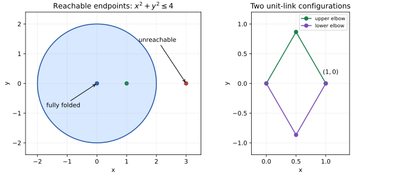

# Worked applications

Each script is an executable source of assertions, with a catalog entry tested against installed wheels outside the source checkout. Run a script after installing the package and its declared dependency profile.

## Principal branches and poles

The [real-graph script](https://github.com/BhuvaneshBhatt/semialg/blob/main/examples/real_graphs.py) checks existence and uniqueness for a selected square root and proves that reciprocal composition retains the excluded input zero. A branch selector, input domain and denominator guard each affect the exact graph.

## Quadratic parameter strata

The [quadratic script](https://github.com/BhuvaneshBhatt/semialg/blob/main/examples/quadratic_strata.py) gives six disjoint guards: a nonzero quadratic coefficient with positive, zero or negative discriminant; a linear equation; a nonzero constant equation; and the zero equation. The guards cover parameter space. Independent exact univariate interval counts check representative finite fibers. Rational coefficient poles require an additional definedness guard.

## Polynomial linkage workspace

Two rigid links of length one have elbow (u,v) and endpoint (x,y), satisfying u²+v²=1 and (x-u)²+(y-v)²=1. Simultaneous rotation preserves both equations. Rotating the endpoint to (r,0), r≥0, reduces real quantifier elimination to one free parameter. The [linkage script](https://github.com/BhuvaneshBhatt/semialg/blob/main/examples/linkage_workspace.py) proves 0≤r≤2, hence the reachable workspace is x²+y²≤4. The constructive elbow (r/2, sqrt(1-r²/4)) verifies sufficiency, including the fully folded endpoint at r=0.

The reduction avoids a large two-parameter Cartesian elimination while preserving the full geometry by rotational invariance. The alggeom application also computes the two-point elbow fiber over endpoint (1,0). Angles are represented by constrained algebraic coordinates; the solver is not treating transcendental trigonometric expressions as polynomials.

The quadratic examples use the exact identity 4a(ax²+bx+c)=(2ax+b)²-(b²-4ac). On a≠0 the affine change is invertible, so a one-parameter real-root projection supplies the discriminant condition. Linear and constant strata are checked separately. This avoids an unnecessarily large three-parameter CAD while preserving the full parameter classification analytically.

